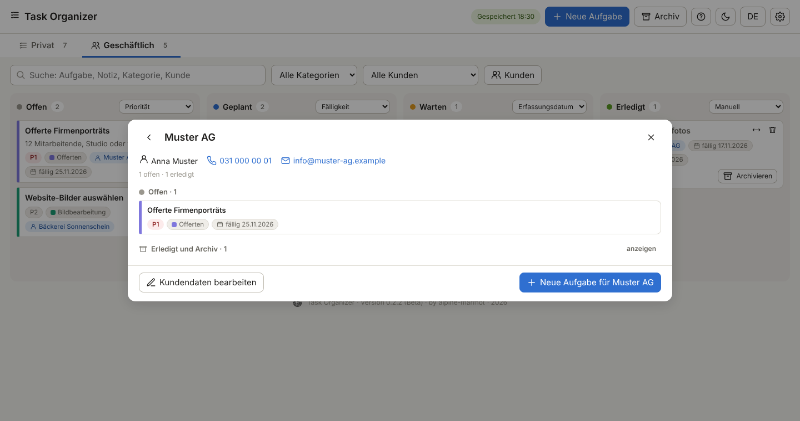

  <picture>
    <source media="(prefers-color-scheme: dark)" srcset="logo-dark.png">
    
  </picture>

<h1 align="center">Task Organizer</h1>

Deutsch · <a href="README.md">English</a>

Ein Kanban-Board für Arbeiten, Aufgaben und To-dos – getrennt in <b>Privat</b> und <b>Geschäftlich</b>, in einer einzigen HTML-Datei. 
Ohne Server, ohne Konto, ohne Internetverbindung.

<b>Version 0.2.2 (Beta)</b> · <a href="CHANGELOG.de.md">Änderungen</a> · <a href="https://alpine-marmot.github.io/task-organizer/">App öffnen</a>

## Funktionen

- **Zwei Bereiche:** Privat und Geschäftlich, je mit eigenen Aufgaben und Kategorien
- **Vier Spalten:** Offen → Geplant → Warten → Erledigt
- **Aufgaben** mit Priorität 1–3, Kategorie, Fälligkeitsdatum und Notiz
- **Kategorien mit Farben:** entstehen beim ersten Eintippen und werden danach vorgeschlagen; die Farbe erscheint als Rand der Karte
- **Kunden** (Bereich Geschäftlich): entstehen automatisch, werden beim Tippen vorgeschlagen, mit Ansprechperson, Telefon und E-Mail
- **Kundenkarte:** Telefon und E-Mail zum Anklicken, alle offenen Aufgaben nach Spalte, erledigte und archivierte Aufgaben, «Neue Aufgabe für …»
- **Wiederkehrende Aufgaben:** täglich, wöchentlich, alle 2 Wochen, monatlich, jährlich oder eigenes Intervall – ab Erledigt oder nach festem Plan
- **Sortierung pro Spalte:** Priorität, Erfassungsdatum, Fälligkeit, Farbe oder manuell
- **Drag & Drop** zwischen und innerhalb der Spalten, dazu ein Menü «Verschieben nach …» auf jeder Karte
- **Doppelklick** auf eine leere Stelle in Offen, Geplant oder Warten öffnet eine neue Aufgabe in dieser Spalte
- **Archiv:** per Knopf oder automatisch nach 14 Tagen (einstellbar), durchsuchbar, wiederherstellbar, CSV-Export für Excel
- **Speichern in eine Datei** nach Wahl (Chrome und Edge), dazu Sicherung exportieren und importieren als JSON
- Helles und dunkles Design, Deutsch und Englisch, Tastenkürzel, Hilfe mit Ablauf-Diagramm

## Loslegen

**Variante 1 – lokale Datei (empfohlen)**

1. `index.html` herunterladen (auf GitHub: Datei öffnen → «Download raw file»).
2. In Google Chrome oder Microsoft Edge öffnen.
3. Im gelben Hinweis auf «Datei wählen» und dann auf «Neue Datei anlegen» klicken. Einen Ordner wählen, zum Beispiel *Dokumente*.
4. Ab jetzt wird jede Änderung automatisch in diese Datei gespeichert. Nach einem Neustart des Browsers einmal auf «Wieder verbinden» klicken.

**Variante 2 – GitHub Pages**

<https://alpine-marmot.github.io/task-organizer/> öffnen und wie oben eine Datendatei einrichten. Die Seite selbst kommt von GitHub, die Aufgaben bleiben trotzdem auf deinem Computer.

## Bedienung

| Was | Wie |
|---|---|
| Neue Aufgabe | Knopf «Neue Aufgabe», `Alt+N` oder Doppelklick auf eine leere Stelle in einer Spalte |
| Aufgabe bearbeiten | Karte anklicken |
| Aufgabe verschieben | Karte ziehen oder Pfeil-Symbol («Verschieben nach …») |
| Bereich wechseln | Reiter oben oder `Alt+B` |
| Kundenkarte | blauen Kunden-Chip auf einer Karte oder Knopf «Kunden» anklicken |
| Archivieren | «Archivieren» auf einer erledigten Karte, «Alle archivieren» oder automatisch |

### Wiederkehrende Aufgaben

Unter **Wiederholen** wählst du, wie oft eine Aufgabe anfällt:

- **Ab Erledigt:** Das nächste Datum zählt ab dem Tag, an dem du die Aufgabe erledigst (z. B. Staubsaugen: 7 Tage später).
- **Nach festem Plan:** Das nächste Datum folgt dem Kalender ab dem Fälligkeitsdatum (z. B. Rechnung immer am 1.).

Sobald eine Karte in **Erledigt** landet, wird die nächste in **Geplant** vorbereitet. Sie erscheint erst kurz vor der Fälligkeit – bei täglich am selben Tag, sonst 2 Tage vorher. Vorbereitete Karten stehen unten in «Geplant» unter «kommende Wiederholungen».

### Tastenkürzel

| Kürzel | Aktion |
|---|---|
| `Alt+N` | Neue Aufgabe |
| `Ctrl+Enter` | Speichern (im Formular) |
| `Alt+1` / `2` / `3` | Priorität (im Formular) |
| `Alt+B` | Bereich wechseln |
| `Ctrl+F` | Suche |
| `Esc` | Fenster oder Menü schliessen |

Auf dem Mac: `Alt` = Wahltaste (⌥), `Ctrl` kann auch Cmd (⌘) sein.

## Browser

| Browser | Speichern in Datei | Hinweis |
|---|---|---|
| Google Chrome | ✓ | empfohlen |
| Microsoft Edge | ✓ | empfohlen |
| Safari | – | Daten nur im Browser; regelmässig eine Sicherung exportieren |
| Firefox | – | Daten nur im Browser; regelmässig eine Sicherung exportieren |

Das Speichern in eine Datei nutzt die *File System Access API*, die nur Chromium-Browser unterstützen. Aus Sicherheitsgründen zeigt der Browser nur den Dateinamen, nicht den Ordner.

**Safari:** Safari kann Website-Daten von Seiten löschen, die 7 Tage nicht benutzt wurden. Wer Safari verwendet, sollte regelmässig eine Sicherung exportieren.

## Daten und Datenschutz

| | |
|---|---|
| **Wo die Daten liegen** | Nur in der gewählten Datendatei und im Browser-Speicher (localStorage / IndexedDB) auf deinem Computer |
| **Internet** | Die App stellt **keine** Verbindung ins Internet her: kein Tracking, keine Cookies, keine Schriften oder Bibliotheken von aussen |
| **Autor** | sieht nichts – es gibt keinen Server |
| **GitHub Pages** | Beim Öffnen der Online-Version erhält GitHub die üblichen Zugriffsdaten (z. B. IP-Adresse) wie bei jeder Website. Deine Aufgaben werden nicht übertragen |

**Kundendaten sind Personendaten.** Namen, Ansprechpersonen, Telefonnummern und E-Mail-Adressen fallen unter das Schweizer Datenschutzgesetz (DSG) bzw. die DSGVO. Nur erfassen, was du brauchst, aktuell halten und löschen, wenn es nicht mehr nötig ist.

**Cloud-Ordner:** Liegt die Datendatei in einem Ordner, der mit einer Cloud synchronisiert wird (iCloud Drive, OneDrive, Google Drive, Dropbox …), werden alle Daten dorthin kopiert, und es gelten die Bedingungen dieses Dienstes. Die App kann das nicht erkennen – bitte selbst prüfen.

Dies ist eine technische Beschreibung, keine Rechtsberatung.

## Lizenz

[MIT](LICENSE) © 2026 alpine-marmot

Ebenfalls von alpine-marmot: [Linkboard](https://github.com/alpine-marmot/linkboard) – eine Browser-Startseite in einer Datei.
