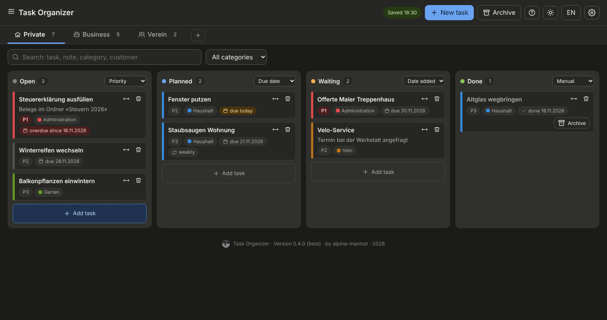
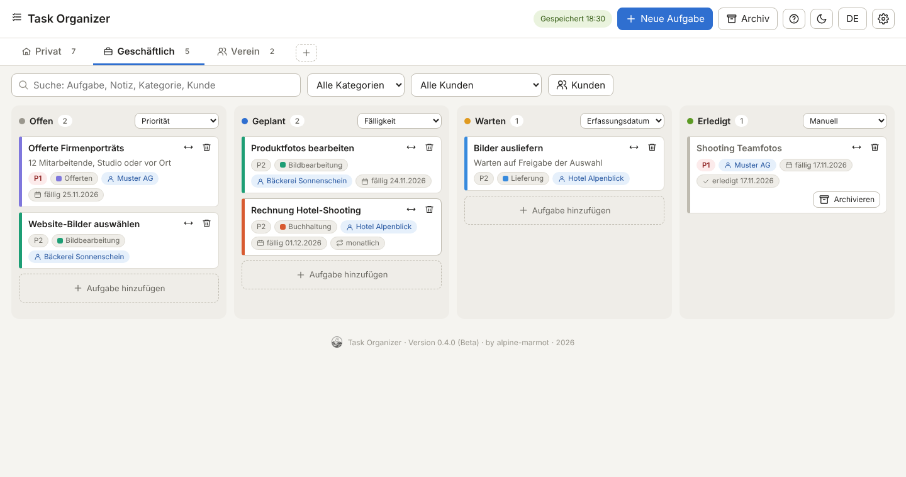
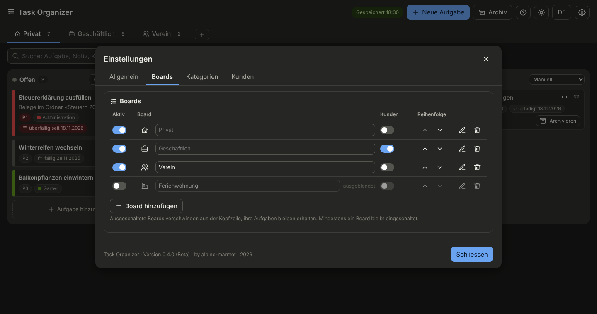
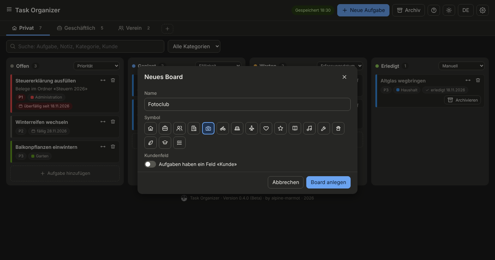
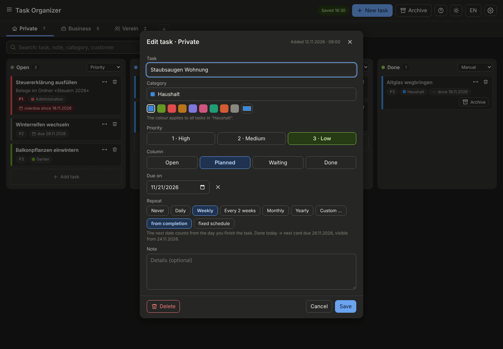
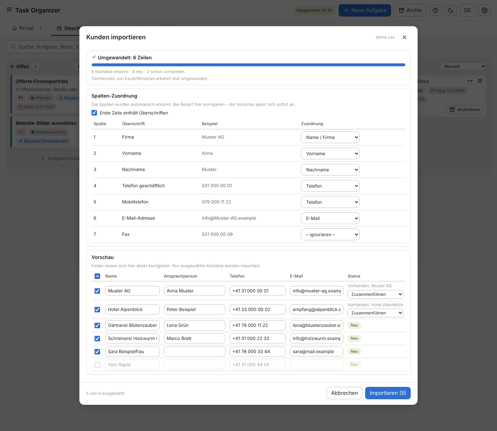
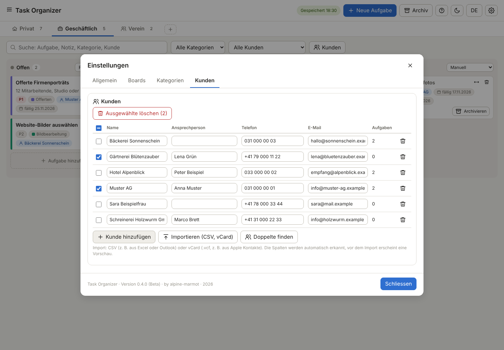
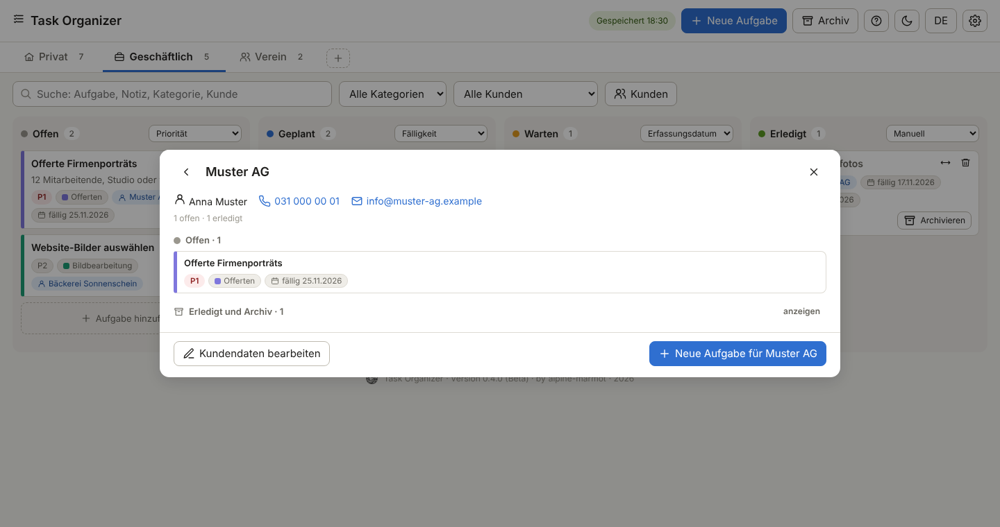

  <picture>
    <source media="(prefers-color-scheme: dark)" srcset="logo-dark.png">
    
  </picture>

<h1 align="center">Task Organizer</h1>

<a href="README.de.md">Deutsch</a> · English

A kanban board for chores, tasks and to-dos – split into <b>Private</b> and <b>Business</b>, in a single HTML file. 
No server, no account, no internet connection needed.

<b>Version 0.4.0 (beta)</b> · <a href="CHANGELOG.md">Changelog</a> · <a href="https://alpine-marmot.github.io/task-organizer/">Open the app</a>

## Features

- **Boards:** Private and Business by default, plus your own boards (e.g. a club) via the **+** in the header – each with its own tasks and categories; switch boards on and off, rename, reorder or delete them
- **Four columns:** Open → Planned → Waiting → Done
- **Tasks** with priority 1–3, category, due date and note
- **Categories with colours:** created automatically the first time you type them, then suggested; the colour shows as the card's edge
- **Customers** (boards with the customer field switched on): created automatically, suggested while typing, with contact person, phone and email
- **Customer card:** clickable phone and email, all open tasks by column, done and archived tasks, "New task for …"
- **Customer import** from CSV (Excel, Outlook …) or vCard (.vcf, Apple Contacts): columns are detected automatically and can be remapped, data is cleaned up (Swiss phone format, email, character set), preview with select/deselect and duplicate handling (merge, keep, replace)
- **Manage customers:** select several with checkboxes and delete them together, find and merge duplicates
- **Recurring tasks:** daily, weekly, every 2 weeks, monthly, yearly or a custom interval – counted from completion or on a fixed schedule
- **Sorting per column:** priority, date added, due date, colour or manual
- **Drag and drop** between and within columns, plus a "Move to …" menu on every card
- **"+ Add task" tile** below the last card in Open, Planned and Waiting – or double-click an empty spot – to add a task to that column
- **Archive:** with a button or automatically after 14 days (adjustable), searchable, restore, CSV export for Excel
- **Saving to a file** of your choice (Chrome and Edge), plus backup export and import as JSON
- Light and dark theme, German and English, keyboard shortcuts, help with a flow diagram

## Getting started

**Option 1 – local file (recommended)**

1. Download `index.html` (on GitHub: open the file → "Download raw file").
2. Open it in Google Chrome or Microsoft Edge.
3. In the yellow notice, click "Choose file", then "Create new file". Pick a folder, for example *Documents*.
4. From now on every change is saved automatically to that file. After restarting the browser, click "Reconnect" once.

**Option 2 – GitHub Pages**

Open <https://alpine-marmot.github.io/task-organizer/> and set up a data file as described above. The page itself is served by GitHub; your tasks still stay on your computer.

## Usage

| What | How |
|---|---|
| New task | "New task" button, `Alt+N`, the "+ Add task" tile in a column, or double-click an empty spot |
| Edit task | Click the card |
| Move task | Drag the card, or use the arrow icon ("Move to …") |
| Switch board | Tabs at the top or `Alt+B` |
| New board | **+** next to the boards or Settings › Boards |
| Customer card | Click the blue customer chip on a card, or the "Customers" button |
| Archive | "Archive" on a done card, "Archive all", or automatically |
| Import customers | "Import" in the customer window or Settings › Customers |

### Boards

Besides *Private* and *Business* you can add as many boards as you like – click the **+** next to the boards, enter a name, pick an icon and decide whether tasks get a *Customer* field. The customer list is shared by all boards with the customer field.

Under **Settings › Boards** you can:
- **switch boards on and off** – a switched-off board disappears from the header, its tasks are kept (handy if you only need *Private*)
- rename boards, change the icon and the customer field
- change the order with the arrows
- delete boards – after a confirmation, including their tasks and categories

At least one board always stays on. `Alt+B` cycles through the active boards.

### Recurring tasks

Choose under **Repeat** how often a task comes up:

- **From completion:** the next date counts from the day you finish the task (e.g. vacuuming: 7 days later).
- **Fixed schedule:** the next date follows the calendar from the due date (e.g. invoice always on the 1st).

As soon as a card lands in **Done**, the next one is prepared in **Planned**. It only appears shortly before it's due – the same day for daily tasks, otherwise 2 days before. Prepared cards are listed at the bottom of "Planned" under "upcoming repeats".

### Importing customers

Click **Import** in the customer window or under *Settings › Customers* and choose a CSV file (Excel, Outlook …) or a vCard (.vcf, e.g. from Apple Contacts).

1. A progress bar shows the conversion.
2. **Column mapping:** columns such as *Company*, *First name*, *Last name*, *Mobile* or *Email* are detected automatically. Change any mapping with the drop-down – the preview updates right away.
3. **Clean-up:** extra spaces are removed, email addresses are lowercased, Swiss phone numbers are formatted (`079 000 11 22` → `+41 79 000 11 22`), Excel/Windows characters (ä, ö, ü) are fixed, and duplicates within the file are merged.
4. **Preview:** all contacts are selected – deselect the ones you don't want and fix fields directly. For customers that already exist, choose *Merge* (fill empty fields, default), *Keep existing* or *Replace with import*.

Under *Settings › Customers* you can tick several customers and delete them together, and **Find duplicates** merges entries with the same name (case, accents and punctuation are ignored) – their tasks are moved to the entry you keep.

### Keyboard shortcuts

| Shortcut | Action |
|---|---|
| `Alt+N` | New task |
| `Ctrl+Enter` | Save (in the form) |
| `Alt+1` / `2` / `3` | Priority (in the form) |
| `Alt+B` | Switch board |
| `Ctrl+F` | Search |
| `Esc` | Close window or menu |

On a Mac: `Alt` = Option (⌥), `Ctrl` can also be Cmd (⌘).

## Browser support

| Browser | Saving to a file | Notes |
|---|---|---|
| Google Chrome | ✓ | recommended |
| Microsoft Edge | ✓ | recommended |
| Safari | – | data only in the browser; export a backup regularly |
| Firefox | – | data only in the browser; export a backup regularly |

Saving to a file uses the *File System Access API*, which only Chromium-based browsers support. For security reasons the browser shows only the file name, not the folder.

**Safari:** Safari may delete website data of pages you haven't used for 7 days. If you use Safari, export a backup regularly.

## Data and privacy

| | |
|---|---|
| **Where data is stored** | Only in the data file you choose and in the browser storage (localStorage / IndexedDB) on your computer |
| **Internet** | The app makes **no** network requests – imported files are processed only in your browser: no tracking, no cookies, no fonts or libraries from the internet |
| **Author** | sees nothing – there is no server |
| **GitHub Pages** | When you open the online version, GitHub receives the usual access data (e.g. IP address) like for any website. Your tasks are not sent |

**Customer data is personal data.** Names, contact persons, phone numbers and email addresses fall under the Swiss Federal Act on Data Protection (FADP/DSG) or the GDPR. Record only what you need, keep it current and delete it when it's no longer needed.

**Cloud folders:** If the data file is in a folder that syncs to a cloud (iCloud Drive, OneDrive, Google Drive, Dropbox …), all data is copied there and that service's terms apply. The app can't detect this – check it yourself.

This is a technical description, not legal advice.

## Customer card

## License

[MIT](LICENSE) © 2026 alpine-marmot

Also by alpine-marmot: [Linkboard](https://github.com/alpine-marmot/linkboard) – a browser start page in a single file.
